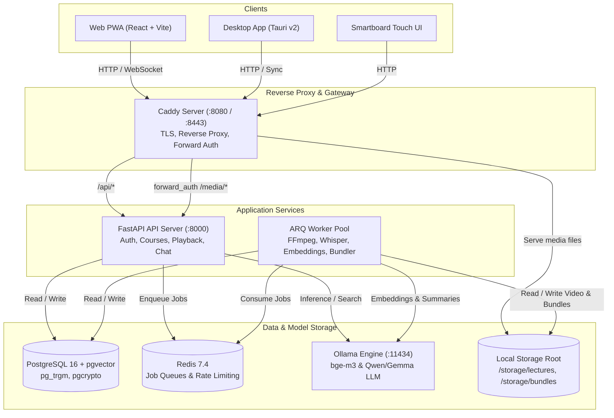
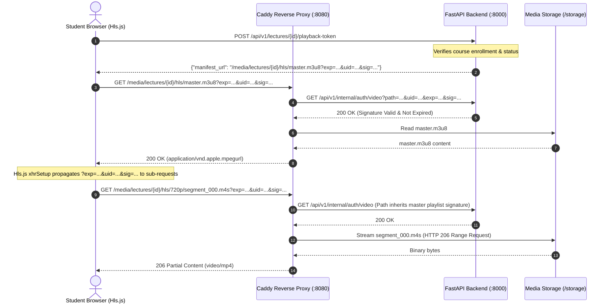
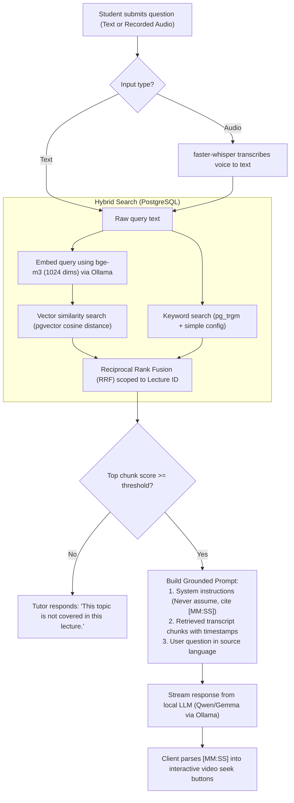
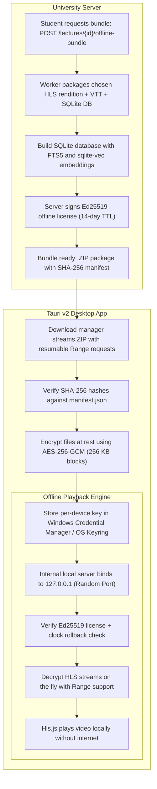

# AI Lecture Platform

A private, offline-capable AI lecture platform built for universities. Professors upload lectures, background workers transcode and transcribe them with bilingual (English + Hindi) speech recognition and vector indexing, students watch via adaptive multi-bitrate HLS with synchronized captions, and an on-premise AI tutor answers queries grounded strictly in lecture content with clickable `[MM:SS]` timestamp citations.

The entire platform runs 100% locally on university hardware with zero data transmitted to third-party clouds or external AI services.

---

## Table of Contents

- [Key Capabilities](#key-capabilities)
- [System Architecture](#system-architecture)
- [Workflows & Execution Flowcharts](#workflows--execution-flowcharts)
  - [1. Lecture Ingestion & Processing Pipeline](#1-lecture-ingestion--processing-pipeline)
  - [2. Secure Playback & Media Delivery](#2-secure-playback--media-delivery)
  - [3. Grounded AI Tutor & RAG Flow](#3-grounded-ai-tutor--rag-flow)
  - [4. Offline Bundle & Desktop Playback](#4-offline-bundle--desktop-playback)
- [Repository Layout](#repository-layout)
- [Tech Stack](#tech-stack)
- [Prerequisites](#prerequisites)
- [Environment Setup](#environment-setup)
- [Run Commands](#run-commands)
  - [1. Infrastructure (Docker)](#1-infrastructure-docker)
  - [2. Backend API (FastAPI)](#2-backend-api-fastapi)
  - [3. Background Worker (ARQ)](#3-background-worker-arq)
  - [4. Web Application (React + Vite)](#4-web-application-react--vite)
  - [5. Desktop Shell (Tauri v2)](#5-desktop-shell-tauri-v2)
- [Default Seed Accounts](#default-seed-accounts)
- [LAN & Production Notes](#lan--production-notes)

---

## Key Capabilities

- **Bilingual End-to-End**: Optimized for English, Hindi, and Hinglish (code-mixed) lectures using `faster-whisper` (`large-v3`) and `bge-m3` (1024-dimensional multilingual embeddings).
- **Strict Grounding**: The AI tutor answers exclusively from retrieved lecture chunks. Every factual statement carries a clickable `[MM:SS]` citation that seeks the video player.
- **Adaptive HLS Streaming**: Multi-bitrate renditions (720p, 480p, 360p) generated via FFmpeg with fragmented MP4 (`fMP4`) containers, thumbnail scrubbing, and WebVTT captions.
- **Zero-Cloud & Air-Gapped**: Runs entirely on campus hardware. No telemetry, no external Speech API, no hosted LLM APIs.
- **Offline DRM & Bundles**: Students can download encrypted lecture bundles to the Tauri desktop app for offline viewing and search, protected by Ed25519-signed licenses and AES-256-GCM chunked encryption.

---

## System Architecture



---

## Workflows & Execution Flowcharts

### 1. Lecture Ingestion & Processing Pipeline

When a professor uploads a lecture recording, an asynchronous pipeline prepares it for streaming, search, and AI Q&A:

```mermaid
flowchart TD
    A["Professor uploads video (Chunked/Resumable)"] --> B["FastAPI saves original file to storage/lectures/{id}/"]
    B --> C["API creates Job record and enqueues 'transcode' in Redis"]
    C --> D["ARQ Worker picks up 'transcode' job"]
    
    subgraph TranscodePipeline["Worker Transcode Pipeline"]
        D --> E["ffprobe analyzes video streams & duration"]
        E --> F["FFmpeg encodes multi-bitrate HLS (720p, 480p, 360p fMP4)"]
        F --> G["Extract poster frame and generate scrubbing thumbnails (thumbnails.vtt)"]
        G --> H["Write master.m3u8 playlist"]
    end

    H --> I["Worker enqueues 'transcribe' job"]
    
    subgraph TranscribePipeline["Speech-to-Text Pipeline"]
        I --> J["faster-whisper (large-v3) transcribes audio"]
        J --> K["Generate timestamped segments (start_ms, end_ms, text, lang)"]
        K --> L["Export captions.vtt"]
    end

    L --> M["Worker enqueues 'index' job"]

    subgraph IndexPipeline["Vector & Keyword Indexing"]
        M --> N["Chunk transcript into 30-60s overlapping windows"]
        N --> O["Generate 1024-d embeddings via bge-m3 (Ollama)"]
        O --> P["Save chunks and vector embeddings to PostgreSQL (pgvector)"]
    end

    P --> Q["Worker enqueues 'chapters' job"]

    subgraph ChaptersPipeline["Chapter & Summary Generation"]
        Q --> R["LLM extracts milestones, chapter titles, and summary"]
        R --> S["Persist chapters to DB and mark Lecture status as 'ready'"]
    end
```



---

### 2. Secure Playback & Media Delivery

Media files are protected by short-lived HMAC-SHA256 tokens verified by Caddy using `forward_auth`:



---

### 3. Grounded AI Tutor & RAG Flow

The student interacts with the AI tutor via text or speech, receiving answers strictly bound to the lecture transcript:



---

### 4. Offline Bundle & Desktop Playback

Enrolled students can download lectures to their desktop for completely air-gapped study:



---

## Repository Layout

```text
apps/
  web/              React 19 + TypeScript + Vite PWA (Student, Professor, Smartboard)
  desktop/          Tauri v2 shell (Rust backend, encrypted local storage, offline player)
services/
  api/              FastAPI application (app/, tests/, alembic/)
  worker/           ARQ workers (transcode, transcribe, index, chapters, bundle)
packages/
  shared/           Shared TypeScript types and API client generated from OpenAPI
infra/
  docker-compose.yml PostgreSQL (pgvector), Redis, Caddy, Ollama
  caddy/Caddyfile    Reverse proxy, forward_auth, signed media URLs
docs/
  ARCHITECTURE.md   System design, threat model, and architectural decisions
  schema.sql        PostgreSQL 16 relational baseline schema
  api.md            Full OpenAPI specification and endpoint reference
  phase1-tasks.md   Implementation backlog and requirement matrix
  runbook.md        Deployment, air-gapped setup, and maintenance guide
storage/            Local media and bundle storage root (gitignored)
```

---

## Tech Stack

| Layer | Technology | Purpose |
| :--- | :--- | :--- |
| **Frontend** | React 19, TypeScript, Vite, Hls.js | Universal PWA and desktop interface |
| **Desktop Shell** | Tauri v2, Rust, Axum, Keyring | Air-gapped playback, encrypted cache |
| **Backend API** | Python 3.12, FastAPI, SQLAlchemy 2 (Async) | REST API, auth, business logic |
| **Job Queue** | Redis 7.4, ARQ | Asynchronous background processing |
| **Database** | PostgreSQL 16 + `pgvector` + `pg_trgm` | Users, courses, transcripts, vector index |
| **Speech-to-Text** | `faster-whisper` (`large-v3`) | Multilingual transcript generation |
| **Embeddings** | `bge-m3` (1024 dimensions via Ollama) | Bilingual vector search (English + Hindi) |
| **LLM Inference** | Ollama (`qwen2.5:7b` / `gemma2:9b`) | Grounded tutor Q&A, chapter extraction |
| **Reverse Proxy** | Caddy 2.9 | TLS, route proxying, signed URL forward_auth |

---

## Prerequisites

- **Docker Desktop** (or Docker Engine v24+ with Compose v2)
- **Node.js** (v20+) and **pnpm** (v10+)
- **Python** (v3.12+) and **uv** package manager
- **FFmpeg & ffprobe** (v6.0+ on system `PATH` for local media workers)

---

## Environment Setup

1. Copy the example configuration to create your local `.env`:
   ```bash
   cp .env.example .env
   ```
2. For Windows environments, run the automated setup script to generate cryptographic signing keys and create required directories:
   ```powershell
   powershell -ExecutionPolicy Bypass -File scripts/setup-dev.ps1
   ```

---

## Run Commands

### 1. Infrastructure (Docker)

Start PostgreSQL (`pgvector`), Redis, Caddy, and Ollama:
```bash
docker compose -f infra/docker-compose.yml up -d --wait
```

Pull the required AI models inside Ollama:
```bash
docker exec infra-ollama-1 ollama pull bge-m3
docker exec infra-ollama-1 ollama pull qwen2.5:7b
```

### 2. Backend API (FastAPI)

Run database migrations, seed initial users, and start the development server:
```powershell
cd services/api
uv sync
uv run alembic upgrade head
uv run python scripts/seed.py
uv run uvicorn app.main:app --host 0.0.0.0 --port 8000 --reload
```

Run API tests and linting:
```powershell
uv run pytest
uv run ruff check .
uv run mypy app/
```

### 3. Background Worker (ARQ)

Start the ARQ background worker to process video transcodes, speech recognition, and vector indexing:
```powershell
cd services/worker
uv sync
uv run arq worker.WorkerSettings
```

Run worker tests:
```powershell
uv run pytest
```

### 4. Web Application (React + Vite)

From the repository root:
```powershell
pnpm install
pnpm --filter web dev
```

Run web tests and typechecks:
```powershell
pnpm --filter web test
pnpm --filter web lint
pnpm --filter web typecheck
pnpm --filter web test:e2e
```

### 5. Desktop Shell (Tauri v2)

Launch the native student desktop shell:
```powershell
pnpm --filter desktop tauri dev
```

---

## Default Seed Accounts

The database seed script (`services/api/scripts/seed.py`) provisions the following accounts:

| Role | Email | Password |
| :--- | :--- | :--- |
| **Professor** | `professor@campus.local` | `ProfessorPassword123!` |
| **Student 1** | `student1@campus.local` | `StudentPassword123!` |
| **Student 2** | `student2@campus.local` | `StudentPassword123!` |
| **Administrator** | `admin@campus.local` | `AdminPassword123!` |

---

## LAN & Production Notes

- **Access URL**: Always access the application through Caddy at `http://localhost:8080` (or `http://<SERVER_IP>:8080` across your local campus network). Caddy routes `/api/*` to the FastAPI backend and securely validates media streaming requests.
- **Firewall**: Ensure incoming traffic on TCP port `8080` is allowed through the host firewall when testing from lab PCs.
- **Signed URLs**: Video manifests and segments are protected by HMAC signatures with a 15-minute expiration. Hls.js automatically propagates signature tokens across variant playlists and segments.
- **Air-Gapped Operation**: For deploying without internet connectivity, follow the step-by-step export and caching instructions in [`docs/runbook.md`](docs/runbook.md).
